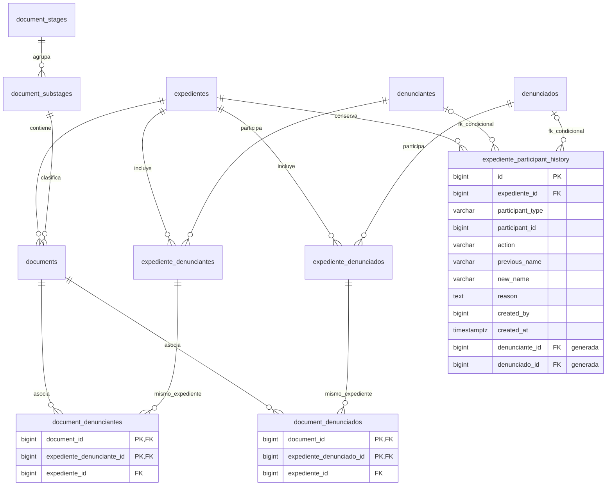

# Persistencia del módulo de Ética CAL

Estructura mínima Go/GORM y PostgreSQL 12 o superior. Incluye endpoints de firma temporal de subida y confirmación de URL de imágenes. Los modelos están en `internal/persistence/models`. Las migraciones SQL son la fuente de verdad: **no usar AutoMigrate**, pues no reproduce columnas generadas, triggers ni todas las restricciones.

## Configuración y arranque

Endpoints de expedientes: `GET /tipos-inicio` devuelve los valores enum disponibles; `POST /expedientes` crea enviando nombre, tipo y fecha de apertura, y `GET /expedientes` lista. La fecha de apertura es independiente de `created_at`. El tipo vive directamente en `expedientes.init_type`, sin tabla catálogo. Ver [contrato y ejemplos PowerShell](docs/expedientes.md).

Los escritos se crean con `POST /escritos` indicando los remitentes por IDs de denunciantes o denunciados; se listan paginados en orden de llegada con `GET /escritos` y su estado se cambia con `PATCH /escritos/{id}/status`. El numero de expediente sigue siendo informativo, sin relacion FK. Ver [contrato y ejemplos](docs/escritos.md).

Los documentos se crean con `POST /expedientes/{id}/documents` y se listan ordenados por etapa con `GET /expedientes/{id}/documents`. Ver [contrato y ejemplos](docs/documents.md).

Denunciantes y denunciados tienen endpoints de creación y listado, y se asocian al expediente con endpoints separados. Las asociaciones se reactivan en la misma fila; los retiros y altas quedan en el historial. Ver [contrato y ejemplos](docs/participants.md).

Completar `.env` en la raíz con los datos PostgreSQL y R2; `.env.example` documenta las variables sin secretos. Las variables del sistema prevalecen sobre `.env`. `.gitignore` excluye `.env`, cachés y ejecutables. No se configura remoto ni se publica en GitHub.

En Cloudflare, crear un bucket R2 y generar credenciales de la API S3 con acceso de lectura/escritura a ese bucket. Copiar Account ID, Access Key ID, Secret Access Key y nombre del bucket a `.env`. No usar el token general de Cloudflare en lugar de las credenciales S3. El cliente usa región `auto` y endpoint `https://<ACCOUNT_ID>.r2.cloudflarestorage.com`; `R2_ENDPOINT` permite especificar el endpoint de una jurisdicción especial. Referencia: [ejemplo oficial Go de Cloudflare](https://developers.cloudflare.com/r2/examples/aws/aws-sdk-go/).

Desde la raíz:

```powershell
go mod download
go run ./cmd/app
```

Swagger UI queda disponible en `http://localhost:8080/swagger/` y el documento OpenAPI en `http://localhost:8080/openapi.json`. La especificación se sirve localmente; Swagger UI carga sus archivos estáticos desde un CDN, así que el navegador requiere Internet para mostrar la interfaz.

El arranque verifica PostgreSQL y R2 y levanta HTTP en :8080. Durante esta etapa temporal, también aplica la migración 006 (nombre y fecha de apertura del expediente) de forma idempotente. Las demás migraciones siguen aplicándose manualmente en orden. Completar también R2_PUBLIC_URL y FRONTEND_ORIGIN. Ver [flujo de imágenes, endpoints y ejemplo frontend](docs/uploads.md).

## Instalación

Con `psql` instalado y `DATABASE_URL` configurada, para una base nueva ejecutar el ?nico archivo consolidado:

```powershell
psql "$env:DATABASE_URL" -v ON_ERROR_STOP=1 -f migrations/001_initial.up.sql
```

Para cargar el conjunto de datos ficticios (solo en pruebas), ejecutar `psql "$env:DATABASE_URL" -v ON_ERROR_STOP=1 -f seeds/demo_data.sql`; crea tres expedientes, participantes, 28 documentos y seis escritos con adjuntos PDF sint?ticos en data URI. El archivo reemplaza ?nicamente filas `[DEMO]`; se puede volver a ejecutar sin duplicarlas y conserva los datos reales.

La ruta de desarrollo `GET /dev/demo-data/reset` vuelve a cargar el fixture y reemplaza ?nicamente filas `[DEMO]`. Est? deshabilitada por defecto; para activarla en un entorno local de pruebas, configurar `ENABLE_DEMO_RESET=true`. No habilitarla en producci?n.

El arranque de la aplicaci?n tambi?n aplica este esquema si no existe `public.expedientes`. La migraci?n incluye tablas, enum, triggers, funciones, ?ndices y el cat?logo inicial de cinco etapas y quince subetapas. Es transaccional y solo debe instalarse una vez.

`migrations/001_initial.down.sql` revierte el esquema **eliminando todos los datos, incluido el historial**; ?sala ?nicamente en entornos desechables. No ejecutar en producci?n.

El esquema consolidado est? destinado a instalaciones nuevas. El arranque aplica `001_initial.up.sql` solo si la base a?n no tiene `public.expedientes`; una base ya existente no se modifica autom?ticamente.

## Relaciones e integridad

Cada documento pertenece a un expediente y a una subetapa; cada subetapa pertenece a una etapa. Las personas se pueden reutilizar entre expedientes y sus nombres no son únicos. Las tablas `expediente_denunciantes` y `expediente_denunciados` tienen ID propio y una restricción única por expediente/persona.

Las tablas `document_denunciantes` y `document_denunciados` tienen PK compuesta y una columna técnica adicional `expediente_id`. Debe enviarse junto con los otros dos IDs. Sus dos FK compuestas garantizan que documento y participante pertenecen al mismo expediente, incluso si se intenta cambiar posteriormente la pertenencia. Se usa RESTRICT para las eliminaciones; para retirar una pertenencia referenciada por documentos, primero deben resolverse esas asociaciones explícitamente.

El historial referencia la persona, no la pertenencia, para sobrevivir a la retirada de participantes. Dos columnas generadas seleccionan la FK válida según `participant_type`; no se permite una referencia a una persona inexistente. Eliminar personas o expedientes con historial está restringido. UPDATE, DELETE y TRUNCATE del historial están bloqueados mediante triggers para el uso normal de la base. El propietario o administrador puede alterar la estructura: la cuenta de aplicación no debe tener privilegios DDL.

Los snapshots `previous_name` y `new_name` son obligatorios según la acción: ADDED requiere nombre nuevo, REMOVED nombre anterior y UPDATED ambos. La futura capa de negocio deberá insertar explícitamente el evento en la misma transacción que el cambio; no se implementa generación automática de eventos. `created_by` es un identificador opcional sin FK porque todavía no existe una entidad de usuarios. Las fechas usan TIMESTAMPTZ, salvo `document_date` (DATE). `updated_at` lo mantiene GORM o el escritor SQL; no hay trigger para actualizarlo.

El archivo se representa exclusivamente por una URL/ruta nullable. Los estados de documento están restringidos a DRAFT, PENDING, APPROVED y REJECTED; el expediente empieza en OPEN, sin imponer un catálogo adicional. Para enviar `is_active=false` mediante GORM, usar una actualización explícita o un mapa que incluya el valor cero, por su etiqueta de valor predeterminado.

## Diagrama ERD



## Verificación

`go test ./...` verifica la compilación de las entidades. Las migraciones requieren validación en una instancia PostgreSQL: aplicar up, ejecutar el seed dos veces y comprobar los conteos (5/15), rechazar asociaciones entre expedientes distintos, duplicados, participantes inexistentes y mutaciones del historial. En el entorno de creación no había PostgreSQL ni Docker disponibles, por lo que esos controles de integración no se ejecutaron.

## Logs de HTTP

La consola del servicio registra cada peticion en JSON con `request_id`, metodo, path, ruta, status, duracion y bytes. Los errores 4xx usan WARN y los 5xx ERROR; los errores de servicio incluyen `error` para diagnostico interno. No se registran cuerpos, cabeceras ni parametros de consulta. Los detalles internos no se devuelven al cliente.

Cada respuesta incluye `X-Request-ID`, expuesto por CORS para que el frontend pueda mostrarlo o registrarlo al reportar un fallo. Buscar ese ID en los logs del despliegue permite correlacionar la respuesta con el backend. Si no existe un registro correspondiente, revisar tambien el proxy, el dominio y el despliegue que recibio la peticion.

Al arrancar se registra `demo_reset_enabled`. Si es `false`, `/dev/demo-data/reset` devuelve 404 y el log indica `demo data reset is disabled`. Habilitar `ENABLE_DEMO_RESET=true` solo en el servicio de desarrollo/pruebas y volver a desplegar o reiniciar para cargar la variable. Swagger documenta la ruta aunque este deshabilitada.

## Borrado completo para pruebas

`DELETE /dev/database/clear` elimina todos los registros de las tablas de la aplicacion, incluidos datos reales, historial, contadores y catalogos de etapas/subetapas. Conserva las tablas, restricciones y triggers; reinicia las identidades y no inyecta datos. No elimina archivos almacenados en R2. Se habilita de forma independiente con `ENABLE_DATABASE_CLEAR=true` y esta deshabilitado por defecto (404). La cuenta PostgreSQL debe poder deshabilitar temporalmente el trigger de TRUNCATE del historial; el borrado y la restauracion del trigger ocurren en una unica transaccion. Si falla, se revierte todo.

El servicio existente `GET /dev/demo-data/reset` sigue reemplazando solo filas `[DEMO]` y cargando el fixture con `ENABLE_DEMO_RESET=true`. Despues de un borrado completo hay que reponer los catalogos de etapas/subetapas antes de cargar documentos con el fixture. Ambas rutas aparecen en Swagger y sus resultados se registran en consola. Estas rutas no tienen autenticacion: habilitarlas unicamente en entornos de desarrollo/pruebas.


El fixture incluye 100 denunciantes y 150 denunciados adicionales (104 y 154 en total). Los participantes muestran nombres ficticios verosimiles y codigos CAL simulados, sin prefijo [DEMO]. La columna interna `is_demo` identifica estas filas para el reset y sus conteos; el seed agrega la columna de forma idempotente en bases existentes. Los codigos no corresponden a colegiados verificados.
