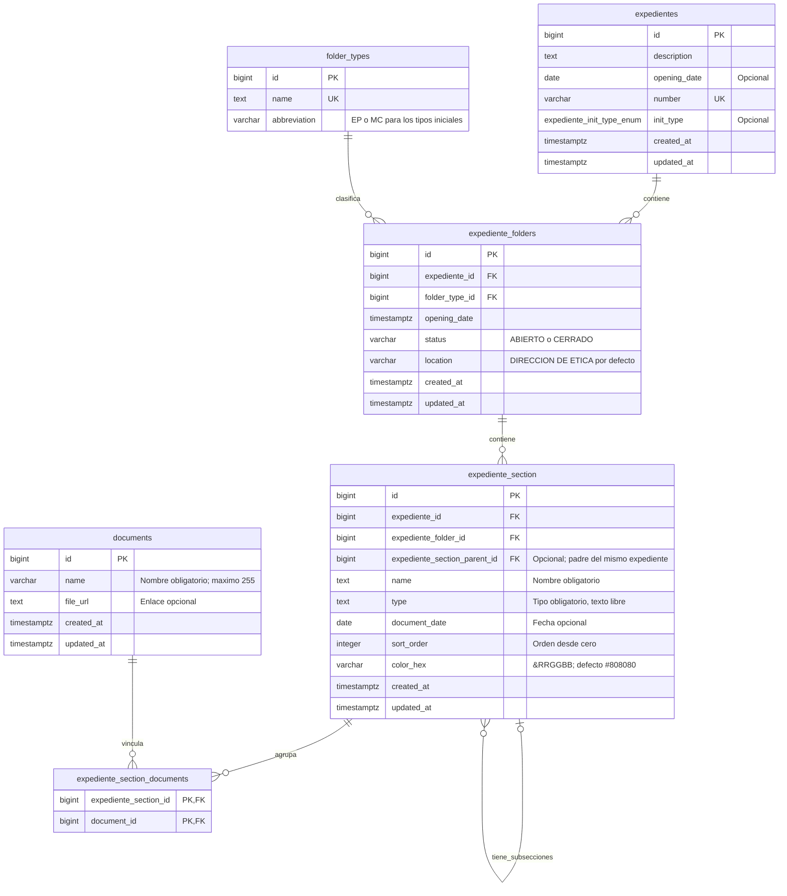
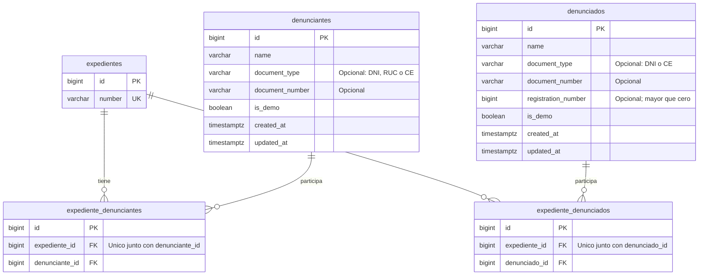
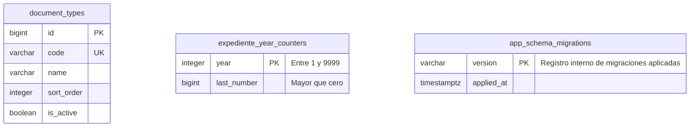

# ERD de expedientes y documentos

Esquema actual: migracion inicial y mejoras 002 a 008, aplicadas automaticamente al iniciar. La 008 mueve el estado y la ubicacion a las carpetas.

## Expedientes, secciones y documentos

- Cada sección pertenece a un único expediente. Un expediente puede tener cero o varias secciones.
- Una sección puede contener varios documentos. La tabla intermedia impide repetir el mismo documento dentro de la misma sección.
- Un documento puede estar en cero o varias secciones, incluso de distintos expedientes: el esquema actual permite esa reutilización.
- El documento se relaciona con el expediente a través de la sección; no tiene `expediente_id` propio.
- Nombre, tipo, fecha, orden y color pertenecen a la sección.
- El estado y la ubicacion pertenecen a cada carpeta. La migracion 008 copia los valores historicos a EXPEDIENTE PRINCIPAL y elimina las columnas del expediente.
- Una carpeta cerrada protege su contenido; un documento compartido se bloquea si alguna de sus carpetas esta cerrada.
- `expediente_section_parent_id = NULL` identifica una raíz. Cada sección puede tener hijas sin límite fijo de profundidad, siempre dentro del mismo expediente y sin ciclos.
- `sort_order` ordena entre hermanas; los empates se resuelven por ID. Para borrar una sección con hijas primero deben moverse o eliminarse sus hijas.
- Eliminar una sección elimina sus vínculos y conserva los documentos. Para eliminar un documento primero deben retirarse sus vínculos.

## Participantes del expediente

## Catalogos y contador conservados

Estos objetos permanecen en la base. `expediente_section.type` es texto libre y no tiene FK hacia `document_types`. Este catálogo ofrece sugerencias de tipo: Escrito de oficio, Resolución y OTROS. El endpoint `GET /document-types` lista las opciones activas por orden.

`document_stages` y `document_substages` no se crean en el esquema consolidado; las secciones reemplazan la organización anterior por etapas.

El contador anual asigna `expedientes.number` mediante un trigger usando el año de `opening_date`; no existe una FK entre ambas tablas. La migración 003 actualiza este comportamiento en bases existentes y se ejecuta automáticamente al arrancar, conservando los números previos.

Las tablas `escritos`, `escrito_denunciantes` y `escrito_denunciados` no se crean en el esquema consolidado.
